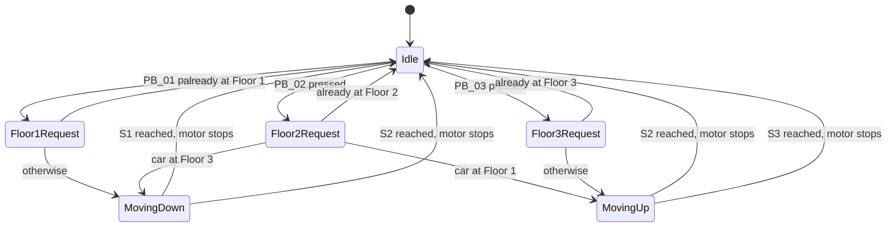

# 🛗 Elevator Control System

**A microcontroller-based 3-floor elevator simulation, built with logic control principles and embedded C/C++.**

---

## 📽️ Demo

  <video src="https://github.com/user-attachments/assets/YOUR-VIDEO-ID](https://github.com/user-attachments/assets/30ae1411-02a2-4474-9593-6ce63ea2d213" width="320" controls muted></video>
   
  Working prototype: the car moving between floors

A short clip of the working physical model is shown above: the car travels along the vertical rail and stops at each floor sensor.

## 📖 Overview

This project is a scaled physical model of an elevator, controlled by a microcontroller. Three floor-call push buttons request a floor, three position sensors tell the controller where the car is, and a motor is driven with a run signal and a direction signal to move the car up or down.

The control logic is written as a **finite state machine (FSM)** in a single Arduino sketch, mimicking the behaviour of a real elevator controller: read the request, decide the direction, move, and stop when the target floor sensor is reached.

## ✨ Features

- 3-floor operation with one call button per floor
- Automatic direction selection (up or down) based on the car's current position
- Stops precisely at the requested floor using position sensors
- Ignores a request if the car is already at that floor
- Simple, readable state-machine code that is easy to extend
- Active-low inputs with internal pull-ups, so no external pull-up resistors are needed

## 🧰 Hardware

| Component | Quantity | Purpose |
|-----------|----------|---------|
| Arduino-Mega | 1 | Main controller |
| Push buttons | 3 | Floor requests (Floor 1, 2, 3) |
| Floor position sensors | 3 | Detect when the car is at each floor |
| DC motor with driver / relay module | 1 | Moves the car up and down |
| Elevator frame, rail and car | 1 | Physical model |
| Power supply | 1 | Powers the board and motor |

> Update this table with your exact board, sensor type and motor driver.

## 🔌 Pin Configuration

| Pin | Name | Type | Description |
|-----|------|------|-------------|
| 6 | `run` | Output | Motor run (`HIGH` = run, `LOW` = stop) |
| 46 | `dir` | Output | Motor direction (`HIGH` = up, `LOW` = down) |
| 2 | `PB_01` | Input (pull-up) | Floor 1 call button |
| 3 | `PB_02` | Input (pull-up) | Floor 2 call button |
| 18 | `PB_03` | Input (pull-up) | Floor 3 call button |
| 19 | `S1` | Input (pull-up) | Floor 1 sensor |
| 16 | `S2` | Input (pull-up) | Floor 2 sensor |
| 17 | `S3` | Input (pull-up) | Floor 3 sensor |

Buttons are **active-low** (pressed = `0`). Sensor `S1` reads `0` when the car is at Floor 1, while `S2` and `S3` read `1` when the car is at Floors 2 and 3, so make sure your sensor wiring matches this polarity.

## 🧠 How It Works

The controller runs a state machine stored in the variable `b`. Each pass through `loop()` advances the state.

**Step by step**

1. **Idle:** the motor is stopped (`run = LOW`, `dir = LOW`).
2. **Read request:** the buttons are checked in order of Floor 1, Floor 2, Floor 3.
3. **Decide direction:** the floor sensors tell the controller where the car is, so it picks up or down. If the car is already at the requested floor, it stays put.
4. **Move:** `dir` is set and `run` goes `HIGH`.
5. **Stop:** the loop waits for the target floor sensor, then returns to idle and stops the motor.

### State Table

| State(s) | Action |
|----------|--------|
| 1 | Stop motor and reset to idle |
| 2–5 | Handle **Floor 1** request (move down until `S1`) |
| 6–11 | Handle **Floor 2** request (move up from Floor 1, or down from Floor 3, until `S2`) |
| 12–15 | Handle **Floor 3** request (move up until `S3`) |

## 🎮 Usage

1. Power on the system. The car idles with the motor stopped.
2. Press a floor button (**1**, **2** or **3**).
3. The car moves in the correct direction and stops at the matching floor sensor.
4. Press another button to travel to a different floor.

## ⚠️ Known Limitations

- Button presses are only read while idle, so requests made while the car is moving are ignored and not queued.
- No button debouncing.
- No timeout or end-of-travel safety limit if a sensor fails to trigger.
- Floor requests have fixed priority (Floor 1, then 2, then 3) when pressed simultaneously.

## 🗺️ Future Improvements

- [ ] Request queue so presses during travel are remembered
- [ ] Door open/close simulation
- [ ] Floor indicator display and direction LEDs
- [ ] Safety timeout and emergency stop button
- [ ] Support for more floors

## 👤 Author

**Sachila Herath** · Electronic & Telecommunication Engineering, KDU
[GitHub](https://github.com/BHMSHBHerath)
